

# 🐟 Bioinspired Atlantic Salmon Robot

**Design, kinematics and hydrodynamic simulation (Discrete Vortex Method) of a cable-driven, multi-link robotic fish inspired by *Salmo salar***

*Course project for 062322 – Bioinspired Robotics · Politecnico di Milano · A.Y. 2025/26*

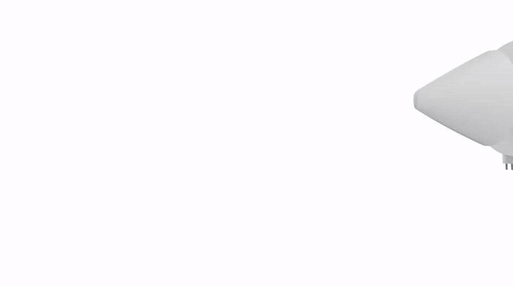

---

## Table of contents

1. [Overview](#1-overview)
2. [Biological inspiration](#2-biological-inspiration)
3. [From fish to robot: kinematic model and joint stiffness](#3-from-fish-to-robot-kinematic-model-and-joint-stiffness)
4. [Mechanical design](#4-mechanical-design)
5. [Electronics and sensors](#5-electronics-and-sensors)
6. [Hydrodynamic simulation (Discrete Vortex Method)](#6-hydrodynamic-simulation-discrete-vortex-method)
7. [Results](#7-results)
8. [Application: coral-reef monitoring](#8-application-coral-reef-monitoring)
9. [Key figures at a glance](#9-key-figures-at-a-glance)
10. [Team and acknowledgements](#10-team-and-acknowledgements)
11. [References](#11-references)

---

## 1. Overview

This project is the full design study of a **bioinspired underwater robot that swims like an Atlantic salmon**. It covers:

- **Biological analysis**: morphology and locomotion mode of *Salmo salar* (subcarangiform BCF swimming).
- **Kinematic modelling**: fitting a chain of rigid links to the measured midline of a real salmon.
- **Joint stiffness identification**: matching the robot's bending response to that of the fish.
- **Mechanical design (CAD)**: a 6-rigid-link body with a soft silicone tail, three independent actuation systems (tail, head, buoyancy), waterproofing and assembly.
- **Electronics**: ESP32 controller, battery pack and an environmental sensor suite.
- **Hydrodynamic simulation**: a **Discrete Vortex Method (DVM)** model coupled with the multibody dynamics, used to compute wake, forces, joint torques, thrust, power and cost of transport.

  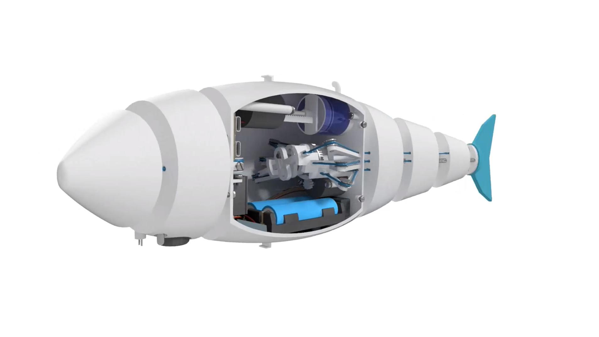

---

## 2. Biological inspiration

### 2.1 The Atlantic salmon

The Atlantic salmon (*Salmo salar*, family Salmonidae) can grow to about **1 m** in length. Its body is **elongated and fusiform**, which keeps hydrodynamic drag low while it swims. The main fins are the pectoral, pelvic, adipose and caudal fins.

  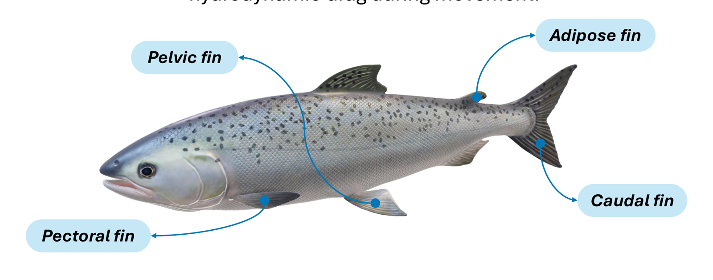

### 2.2 Locomotion mode

Within **Body and/or Caudal Fin (BCF)** swimmers, the salmon is a **subcarangiform** swimmer. Most of its thrust comes from a travelling wave that runs along the rear **1/3 – 1/2** of the body and ends at the caudal fin.

  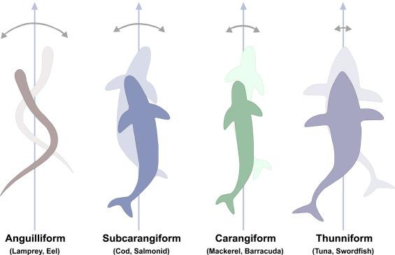

### 2.3 How the fish adapts to speed

The literature [1], [2] shows that as swimming **speed increases**, the salmon:

- raises its **tail-beat frequency**,
- increases the **amplitude** of the travelling wave,
- **stiffens** its body.

This means stiffness and the wave parameters cannot be chosen at random. They have to come from biological data, which is the starting point of the model below.

---

## 3. From fish to robot: kinematic model and joint stiffness

### 3.1 Midline fitting and link layout

The body midline of a swimming salmon was digitised and approximated with a chain of rigid links connected by revolute joints. Joint positions were placed to reproduce the real trajectory as closely as possible.

  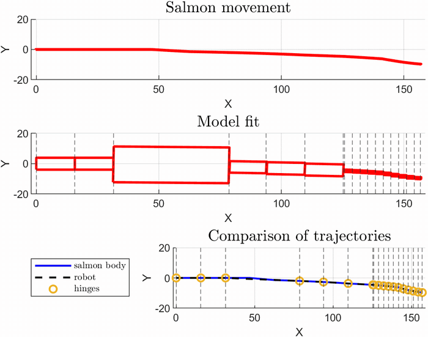

*Animated: the real salmon midline (top), the fitted rigid-link model (middle) and the comparison of the two trajectories over a full swimming cycle (bottom).*

The resulting body plan (as a fraction of total length):

| Segment | Composition | Role |
|---|---|---|
| **Head** | 2 links (≈ 10 % + 10 %) | Actuated / passive. Works as a rudder for steering and agility |
| **Mid-body** | Rigid hull (≈ 50 % incl. head) | Holds the transmission, power supply and controller |
| **Rigid tail** | 3 actuated links (≈ 10 % each) | Generates the travelling wave |
| **Flexible tail** | Soft silicone + caudal fin | Passive. Gives compliance near the fin |

  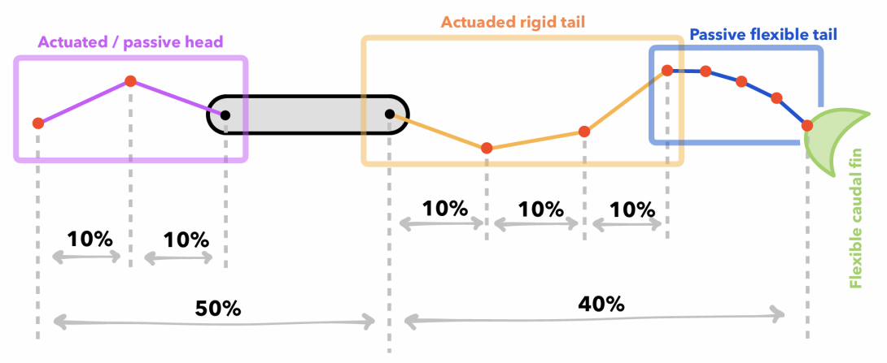

### 3.2 Design requirements

| Requirement | Goal | Implementation |
|---|---|---|
| **Slender body** | Keep drag low → higher efficiency | Hull follows the real salmon outline. The whole robot is covered in a silicone skin |
| **High manoeuvrability** | Agile turning | Two actuated head links driven by an independent motor |

  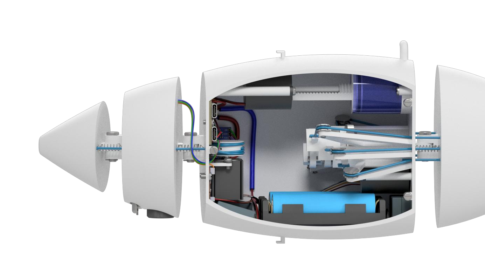

### 3.3 Joint stiffness identification

The passive dynamics of the robot depend heavily on the torsional stiffness of each joint. The stiffness values were identified in four steps:

1. **Extract** the relevant parameters from experimental data on salmon [1].
2. **Rebuild** both the fish and the robot in a simulation environment.
3. **Apply a known moment** to the modelled fish and record its deformed shape.
4. **Repeat for the robot**, tuning each joint stiffness $K_i$ until the deformation matches the fish.

  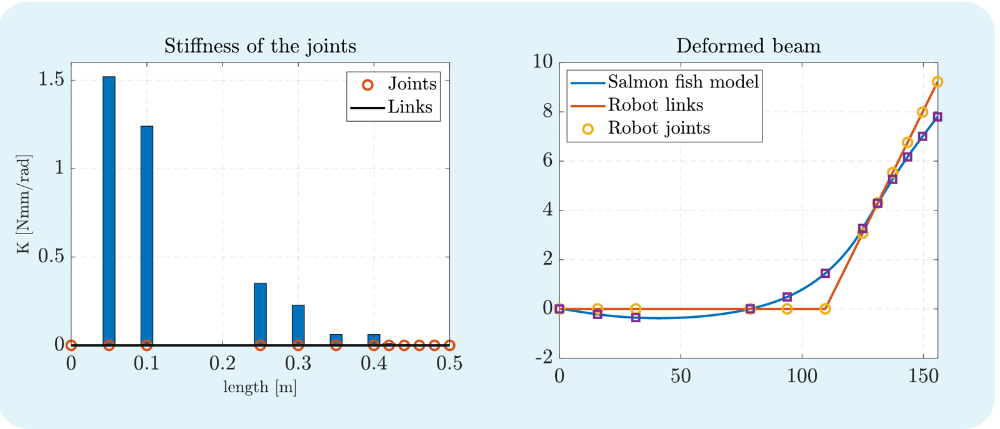

*Left: identified joint stiffness $K$ [N·m/rad] along the body length. Right: deformed beam, comparing the salmon model with the robot links/joints.*

The stiffness is highest near the head (≈ 1.2–1.5 N·m/rad) and drops by more than an order of magnitude towards the tail. This matches the real fish: a stiff anterior body and a compliant posterior body. In hardware, the stiffness is provided by **springs placed at each pivot** (see §4.2).

---

## 4. Mechanical design

  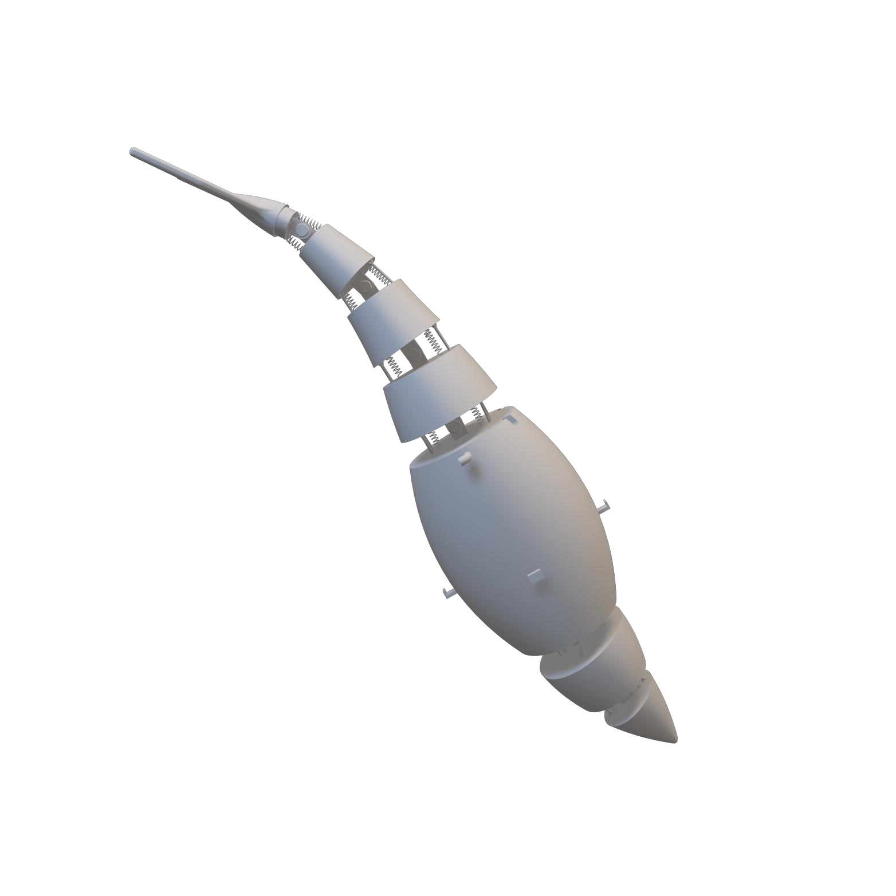
  &nbsp;&nbsp;
  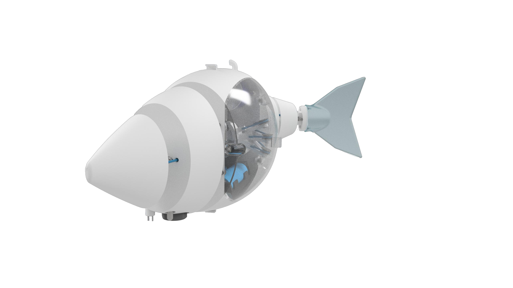

- **6 rigid links**. One of them (the mid-body) houses all the electronics.
- **Structural parts:** ABS plastic.
- **Skin:** soft silicone that fully encloses the robot.
- **Transmission:** **Dyneema** cables, chosen for low friction and low backlash.

  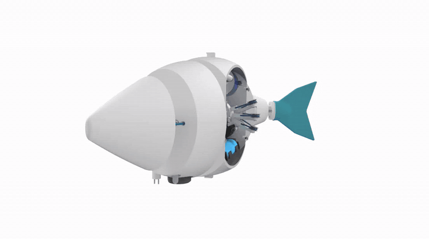

*CAD animation: the robot assembling link by link, from the nose cone and mid-body hull to the tail segments and caudal fin.*

### 4.1 Actuation architecture

Each body region has its own motor:

| # | Motor | Function | Mechanism |
|---|---|---|---|
| 1 | **Main motor** (brushless, Skywalker 2312SL-1250KV) | Tail undulation | 3 coupled Scotch-yoke mechanisms + antagonistic cables |
| 2 | **Front motor** (servo) | Head steering | Pulley + cable |
| 3 | **Top motor** | Buoyancy control | Worm gear + rack driving a piston/reservoir |

  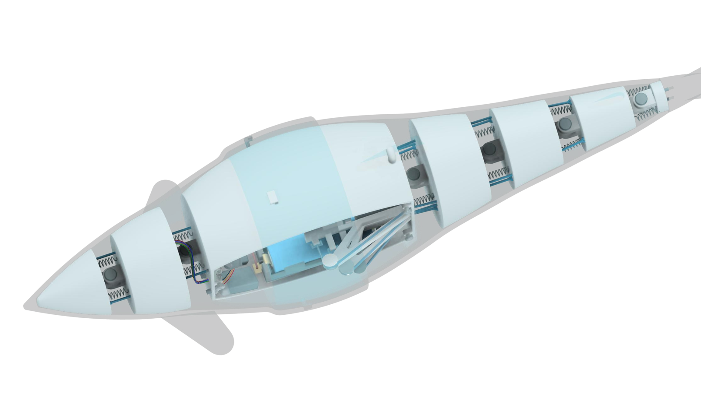

### 4.2 Tail drive: Scotch-yoke travelling-wave generator

A single brushless motor drives **three dependent Scotch-yoke mechanisms**. Each yoke turns the rotation of a crank disc into a sinusoidal linear motion, which pulls a pair of antagonistic cables connected to one active tail link. Offsetting the cranks by a fixed phase produces a **travelling wave** from one motor:

$$
\varphi = 20^\circ \quad \text{(phase shift between consecutive active links)}
$$

  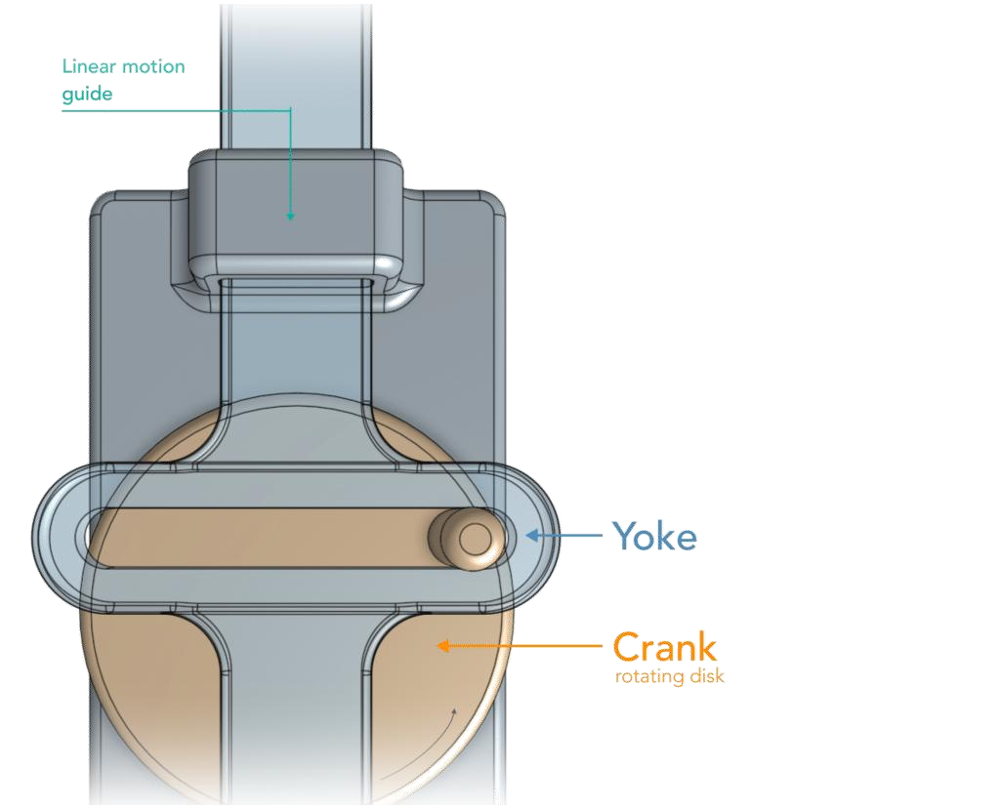
  &nbsp;
  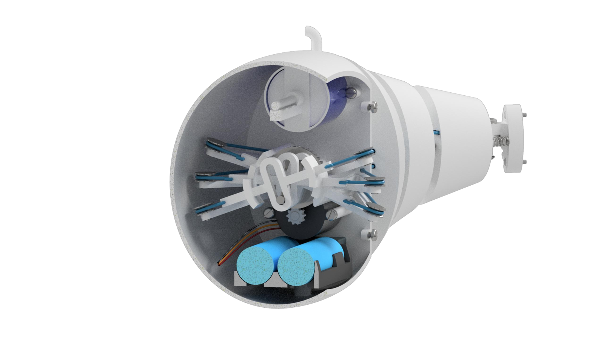

  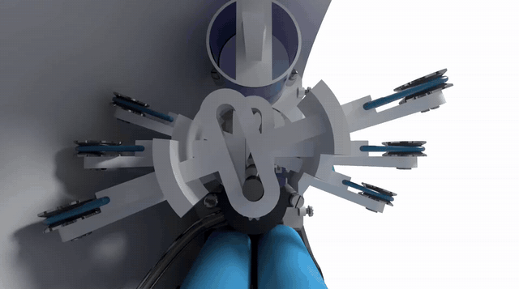

*Close-up animation of the three Scotch yokes driven by the main motor. The phase shift between the yokes is what produces the travelling wave along the tail.*

Each tail link is connected to the previous one through a **pivot and a spring**. The spring gives the identified stiffness, and the **antagonistic cable pair** makes sure the link is driven in both directions.

  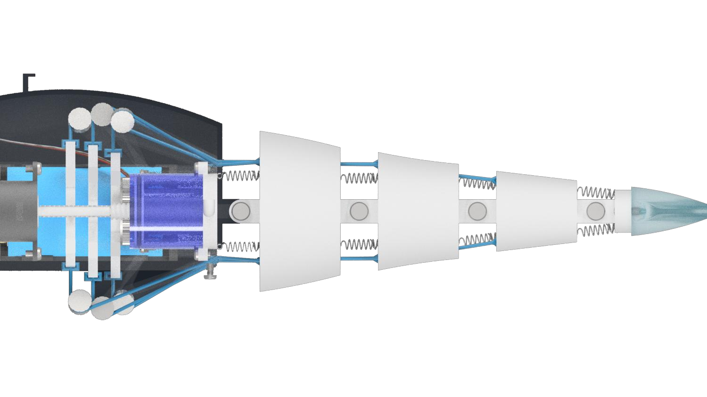
  &nbsp;
  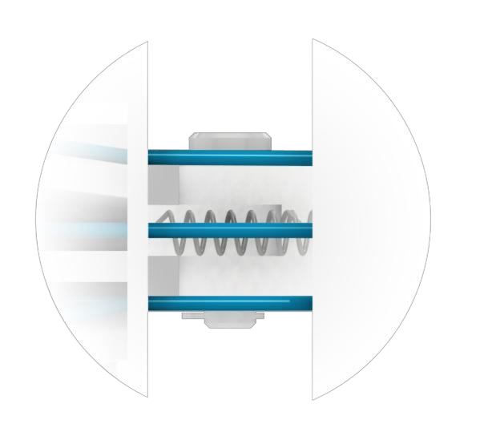

### 4.3 Head drive: active rudder

A servo motor drives the two head links through a pulley and cable. The head can then act as a **rudder** for steering, or add to body undulation when more agility is needed.

  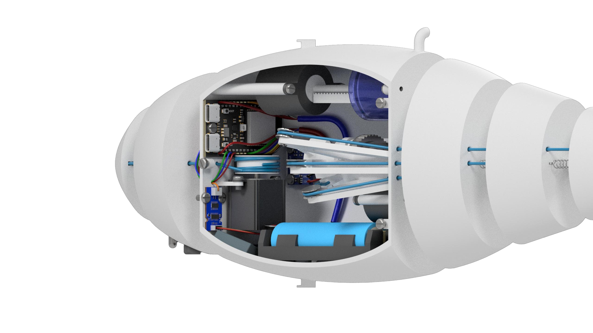

  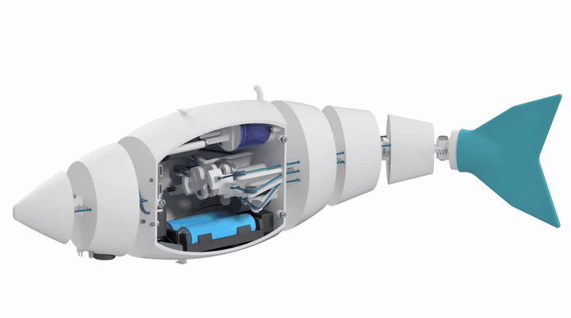

*CAD animation of the full swimming motion: the tail generates the travelling wave while the two head links swing as a rudder for steering and agility.*

### 4.4 Buoyancy system

The top motor drives a **worm gear and rack** that fills or drains an internal reservoir. Filling it makes the robot **dive**, and draining it makes the robot **surface**. The maximum vertical speed is:

$$
V_{\max,\ d/a} = 0.23~\text{m/s}
$$

  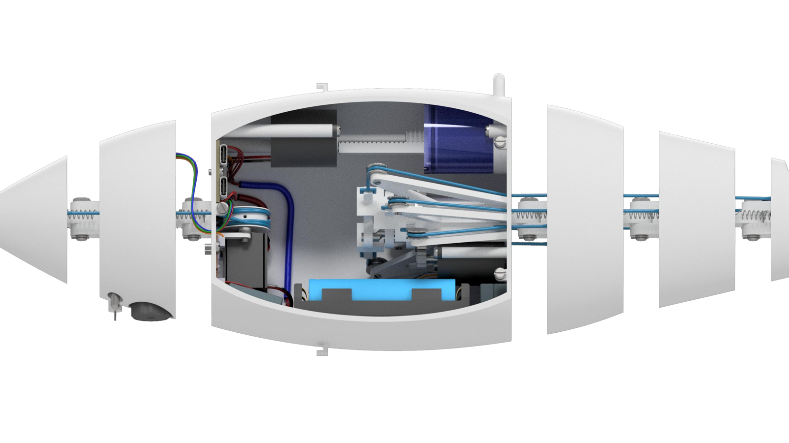

Adhesive **lead ballast weights** (25 g blocks) give the robot **neutral buoyancy** and **lower its centre of mass** for roll stability.

### 4.5 Waterproofing

All mechanical and electrical parts sit inside an **external silicone skin**. The skin is split into **two parts** so it is easier to fit, and **staple-shaped brackets** hold it tight and in place.

  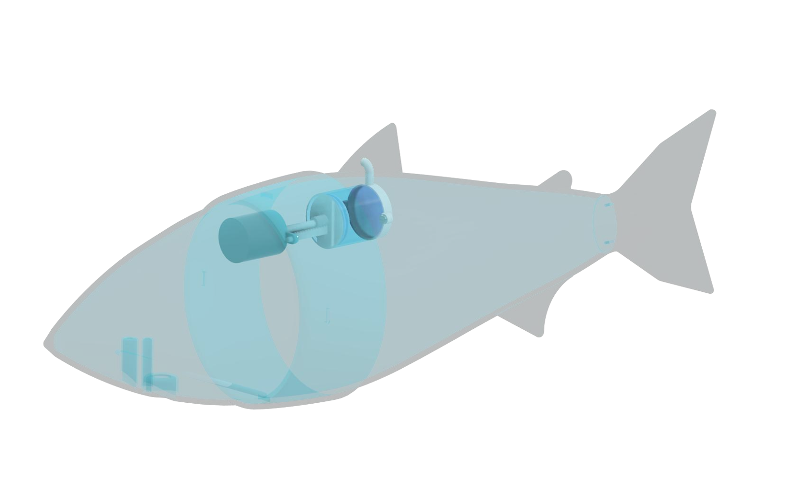

### 4.6 Assembly

- Links are joined with **steel pins** held by **Seeger (circlip) rings**.
- A **removable cover** gives access to the inside.
- All other parts are **press-fit** or fixed with **M3 screws**.

  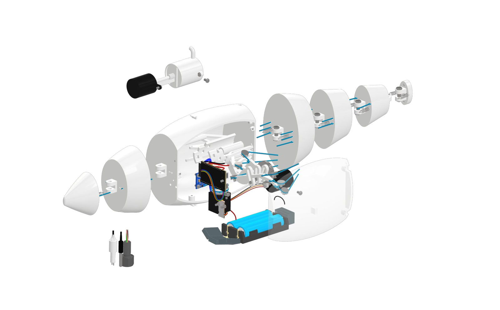
  &nbsp;
  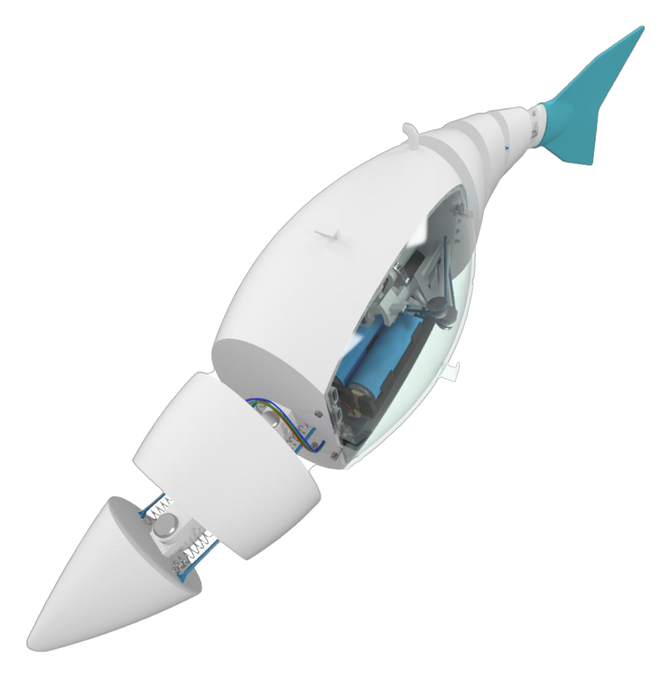

---

## 5. Electronics and sensors

| Component | Model | Purpose |
|---|---|---|
| Microcontroller | **ESP32** | Control and data handling |
| Power | **2 × 18650 Li-ion (3.7 V), in series** | ≈ 7.4 V nominal supply |
| Temperature sensor | **DS18B20** (waterproof) | Water temperature |
| Water quality | **Grove TDS** | Total dissolved solids |
| Pressure / depth | **Bar30** (BAR30-ASM-R2) | Depth estimation |
| IMU | **MPU-6050** (3-axis accelerometer + 3-axis gyroscope) | Attitude and motion |

  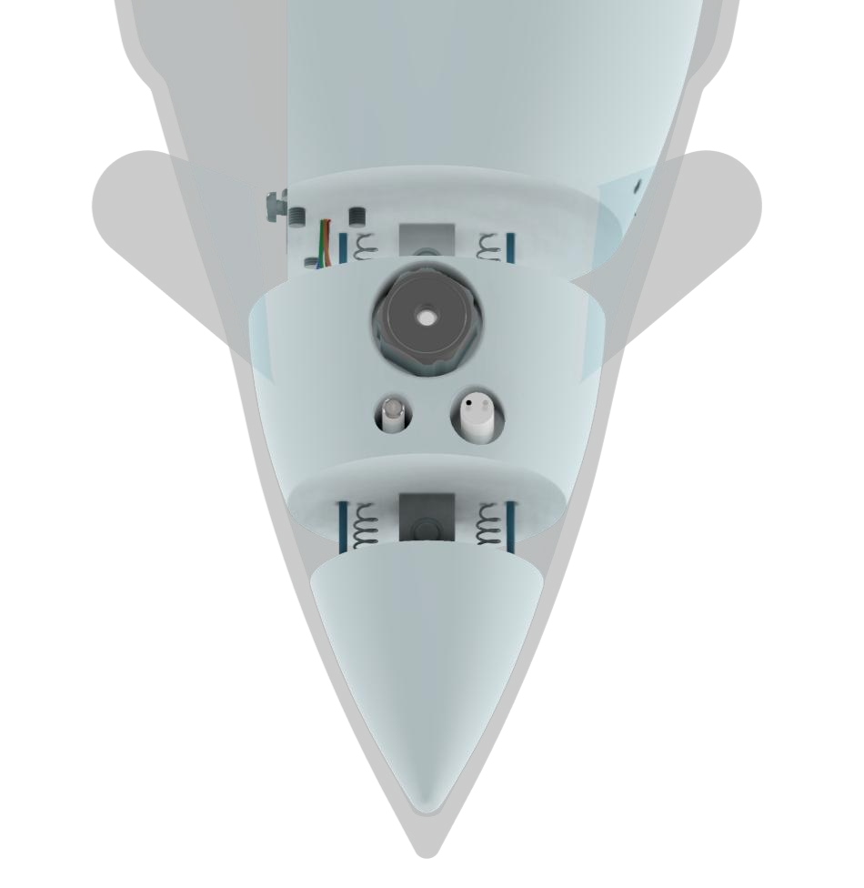
  &nbsp;
  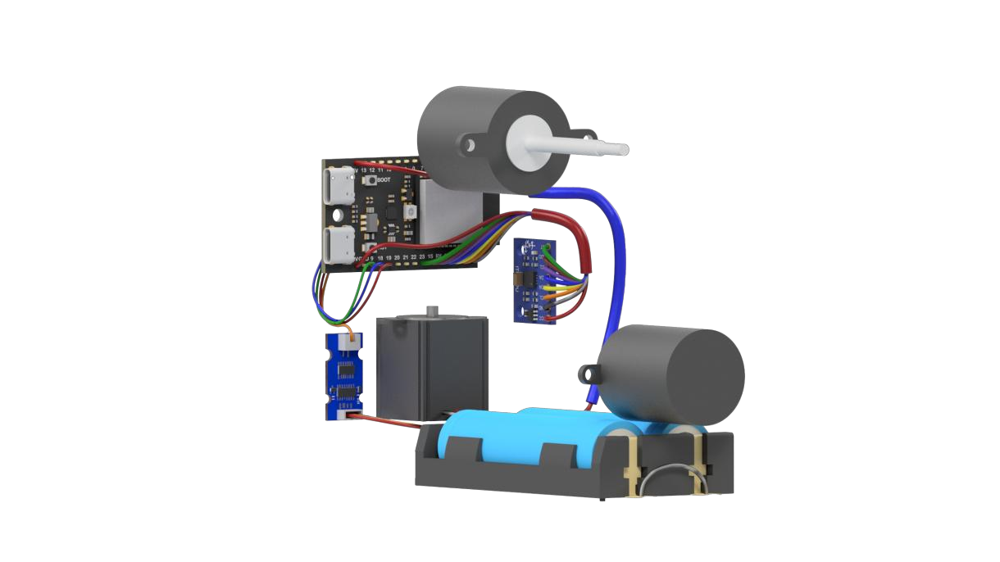

---

## 6. Hydrodynamic simulation (Discrete Vortex Method)

### 6.1 Method

The fluid–structure interaction was modelled with the **Discrete Vortex Method**. The body is a chain of thin links. At each time step, vortices are shed from the links into the wake, and their induced velocities give the **hydrodynamic forces** on every link. These forces are coupled to the multibody equations of motion of the robot (active joints driven kinematically, passive joints governed by the identified springs).

**Simulation inputs**

| Parameter | Value |
|---|---|
| Total mass $m_{tot}$ | 1.2 kg |
| Total length $L_{tot}$ | 0.5 m |
| Tail-beat frequency $f$ | 2 Hz |
| Joint stiffness $K_i$ | from §3.3 |
| Wave amplitude | imposed on the active links |

**Outputs:** wake vortex field, link kinematics, body displacement and velocity, link forces, joint torques, thrust, power, cost of transport.

### 6.2 Validation of the operating point

The chosen parameters were checked against the dimensionless groups typical of real fish swimming:

$$
Re = \frac{U L_{tot}}{\nu} \approx 10^{5} - 10^{6}
$$

$$
St = \frac{2 f A}{U} \approx 0.2 - 0.4
$$

Here $U$ is the swimming speed, $\nu$ is the kinematic viscosity of water and $A$ is the tail-tip amplitude. A Strouhal number in the range 0.2–0.4 is where swimming animals reach peak propulsive efficiency.

### 6.3 Imposed kinematics

The three active tail joints follow a sinusoidal law in **relative angles**, with a constant phase lag between consecutive joints:

$$
\theta_i(t) = \Theta_i \sin\left(2\pi f t - (i - i_0) \varphi\right), \qquad i \in \lbrace 4,5,6 \rbrace,\quad \varphi = 20^\circ
$$

The passive joints (head and flexible tail) respond to the hydrodynamic loads through their springs.

---

## 7. Results

### 7.1 Simulated motion and wake

  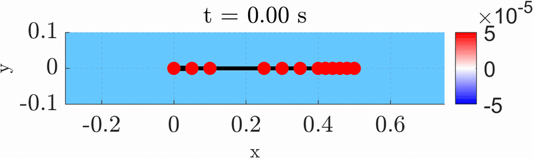

*Animated DVM simulation: the link chain (red dots = joints) undulates and sheds vortices into the wake, coloured by circulation.*

  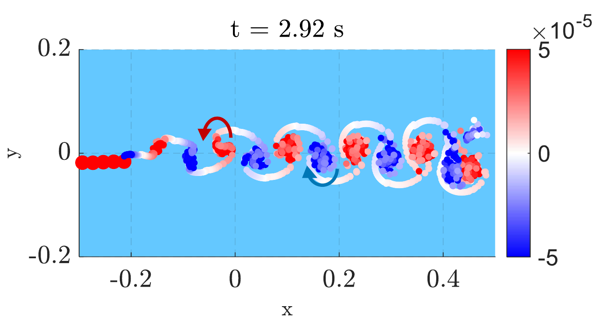

*Snapshot at t = 2.92 s, once the wake is fully developed.*

The simulation produces a clear **reverse Kármán vortex street**. Red vortices rotate counter-clockwise and blue vortices rotate clockwise, which creates a **jet** behind the tail with a velocity surplus. This is the hydrodynamic signature of **thrust-producing** swimming, as opposed to the drag wake behind a bluff body.

### 7.2 Joint kinematics

| Active links | Passive links |
|---|---|
| 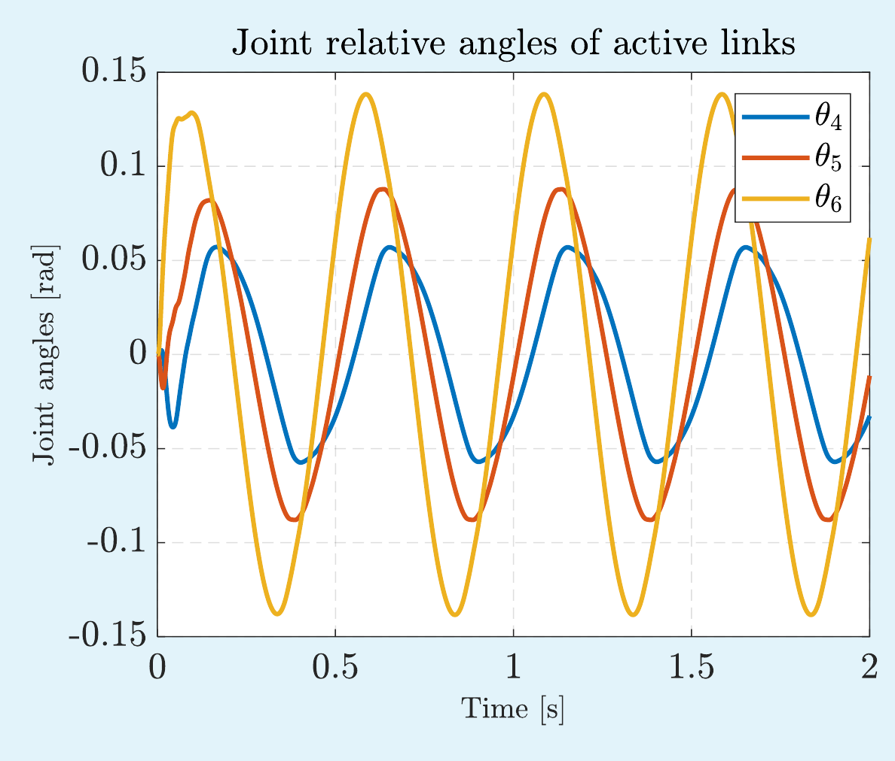 | 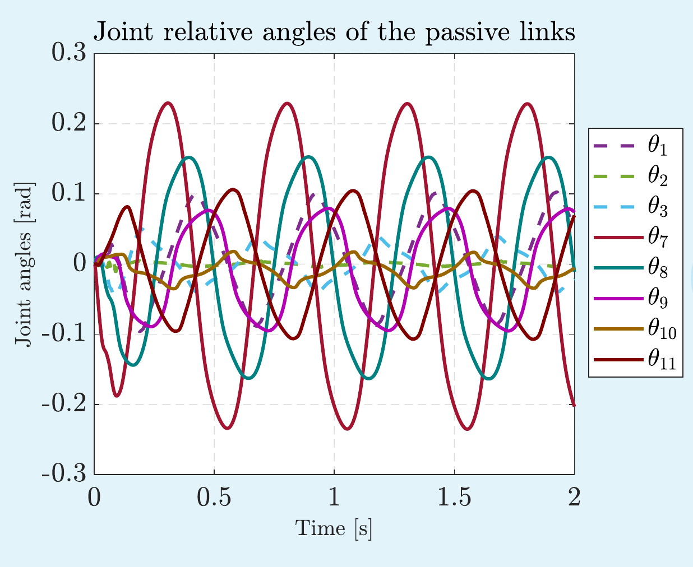 |

- **Active links** ($\theta_4$–$\theta_6$) track the imposed sinusoids with the expected phase shift, which confirms the simulation is set up correctly.
- **Passive links**: in the tail-side links, the amplitude **decreases towards the caudal fin**. The compliant segments filter the motion as intended.

### 7.3 Displacement and velocity

| Displacement | Velocity |
|---|---|
| 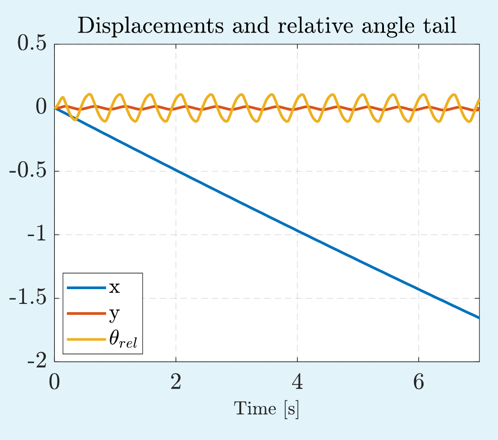 | 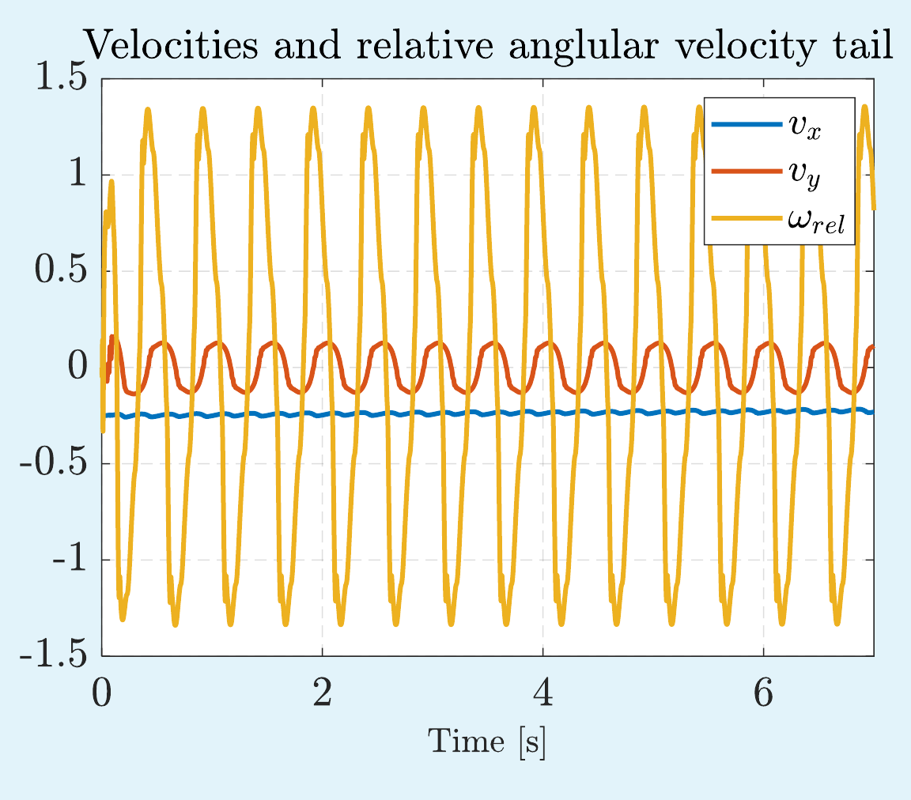 |

- **x (swimming direction):** after a short transient, displacement grows **linearly**, i.e. a **constant cruising speed**. From the plot, the robot covers about 1.6 m in about 7 s, so $U \approx 0.23$ m/s (≈ 0.46 body lengths/s).
- **y (lateral):** a small oscillation from the body undulation (recoil), with no drift.
- As a cross-check, $Re = U L_{tot}/\nu \approx 0.23 \cdot 0.5 / 10^{-6} \approx 1.2 \times 10^5$, which falls in the target range of §6.2.

### 7.4 Hydrodynamic forces

  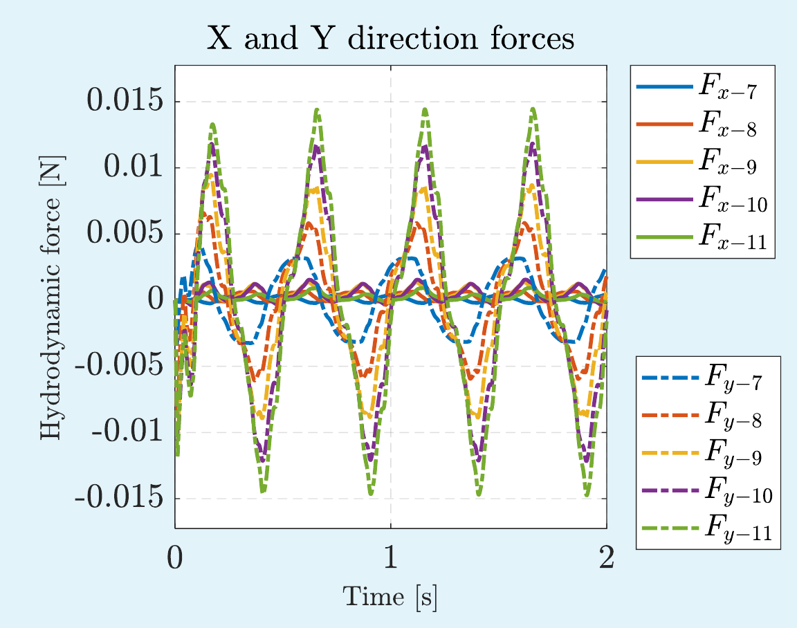

The x- and y-forces on the thrust-producing links (7–11) oscillate at the tail-beat frequency. The **peak force grows towards the caudal fin**, where it reaches its maximum. This is expected, since the fin has the largest lateral velocity and angle of attack.

### 7.5 Joint torques and power

  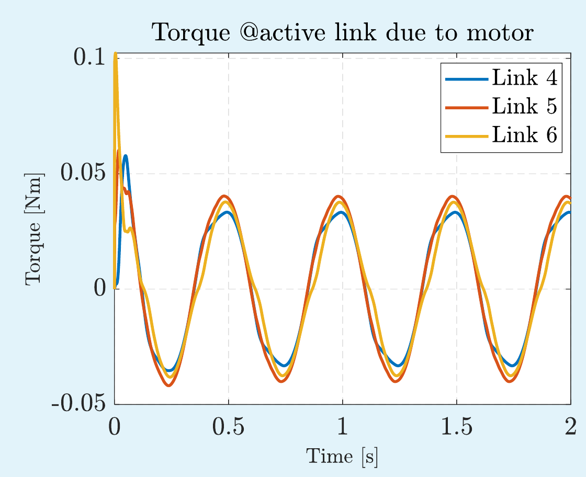

After the start-up transient, the torques on the active links settle into a **stable periodic behaviour**. They show the expected phase shift, and their values (≈ ±0.04 N·m) are consistent with the robot's characteristics. Combining torque and joint angular velocity gives the required mechanical power:

$$
P = \sum_{i} \tau_i \dot\theta_i \quad\Rightarrow\quad P_{nom} \approx 0.6~\text{W}
$$

This is well within the capacity of the selected brushless motor and battery pack.

### 7.6 Thrust

  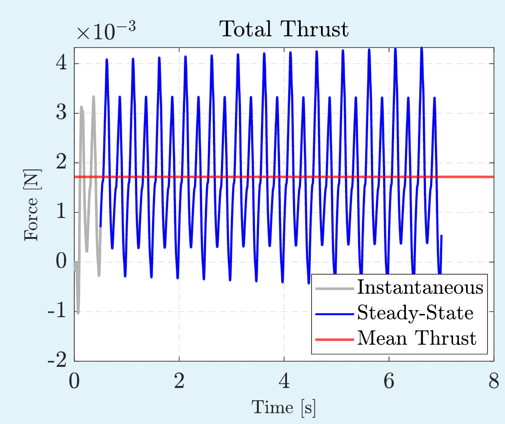

The instantaneous thrust is the sum of the x-forces on the propulsive links:

$$
T(t) = \sum_{i=7}^{11} F_{x,i}(t), \qquad \bar{T} \approx 1.72 \times 10^{-3}~\text{N}
$$

The mean value $\bar T$ is computed over the steady-state window only, with the initial transient (grey) excluded. Thrust oscillates at twice the tail-beat frequency, because each half-stroke produces a positive peak.

### 7.7 Cost of Transport

$$
CoT = \frac{E}{m \cdot d} \quad \left[\frac{\text{J}}{\text{kg}\cdot\text{m}}\right]
$$

The CoT is the energy needed to move one unit of mass over one unit of distance. It was mapped over a grid of **tail-beat frequencies** and **amplitudes** (maximum displacement of the 3rd active link):

  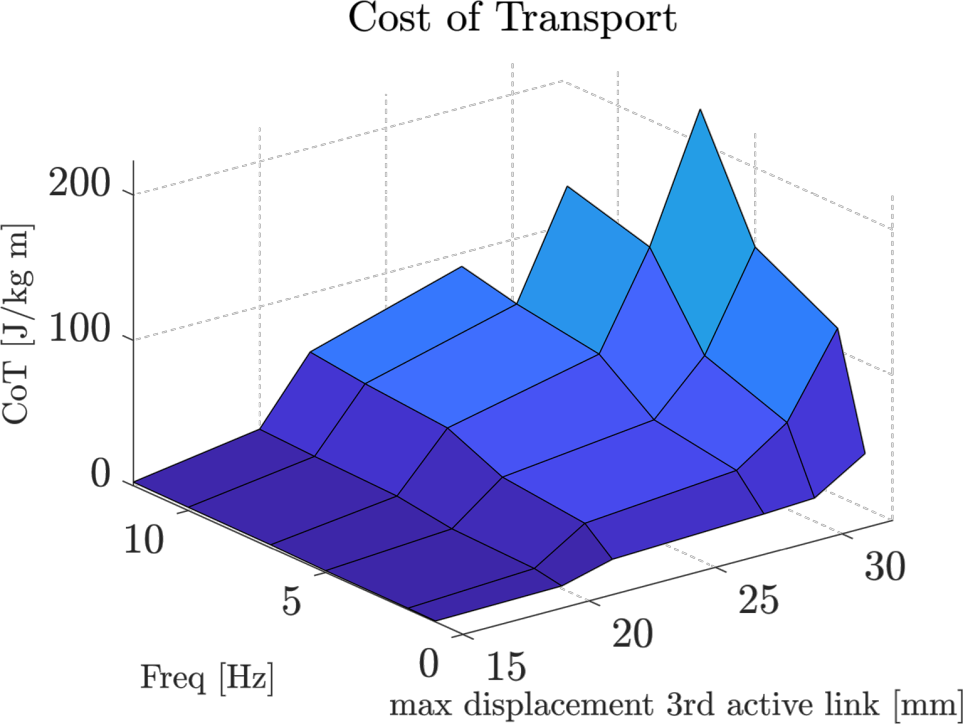

CoT stays low at moderate frequencies and amplitudes and **rises sharply at high frequency combined with large amplitude**. Pushing either parameter too far wastes energy, which mirrors the biological finding that fish tune frequency, amplitude *and* stiffness together to stay efficient (§2.3). The map can be used to choose an energy-optimal gait for a given target speed.

---

## 8. Application: coral-reef monitoring

A quiet, fish-like robot is well suited to **marine environmental monitoring**, where propeller-driven vehicles can disturb wildlife and stir up sediment. With its sensor suite, the robot could:

- monitor **water quality** (temperature, TDS, depth),
- detect **pollution** events,
- carry out **visual inspections of coral health**.

  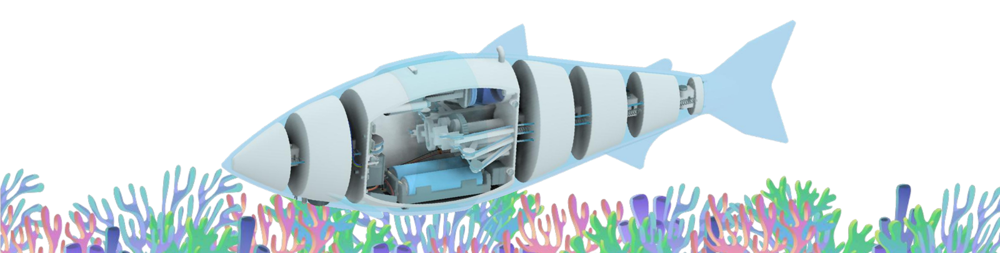

---

## 9. Key figures at a glance

| Quantity | Value |
|---|---|
| Total length / mass | 0.5 m / 1.2 kg |
| Rigid links | 6 (+ soft silicone tail) |
| Motors | 3 (tail – brushless, head – servo, buoyancy) |
| Tail-beat frequency (nominal) | 2 Hz |
| Phase shift between active links | 20° |
| Max dive / ascent speed | 0.23 m/s |
| Simulated cruising speed | ≈ 0.23 m/s (read from displacement plot) |
| Mean thrust | ≈ 1.72 mN |
| Nominal mechanical power | ≈ 0.6 W |
| Reynolds / Strouhal (target) | $10^5$–$10^6$ / 0.2–0.4 |

---

## 10. Team and acknowledgements

*062322 Bioinspired Robotics*, Politecnico di Milano, A.Y. 2025/26.

> Christian Menini - Max Bucci - Fabio Caldironi - Giuseppe Crippa - Erwin Rafael Novicio - Luca Burini

---

## 11. References

[1] S. Ásgeirsson, *Motion Analysis of Arctic char and Atlantic salmon*, 2013.

[2] W. E. K. Agbeti, A. P. Palstra, S. Black, L. Magnoni, M. Lankheet, H. Komen, "Swimming at Increasing Speeds in Steady and Unsteady Flows of Atlantic Salmon *Salmo salar*: Oxygen Consumption, Locomotory Behaviour and Overall Dynamic Body Acceleration," *Biology*, 2024.

---

Politecnico di Milano · Bioinspired Robotics 2025/26

